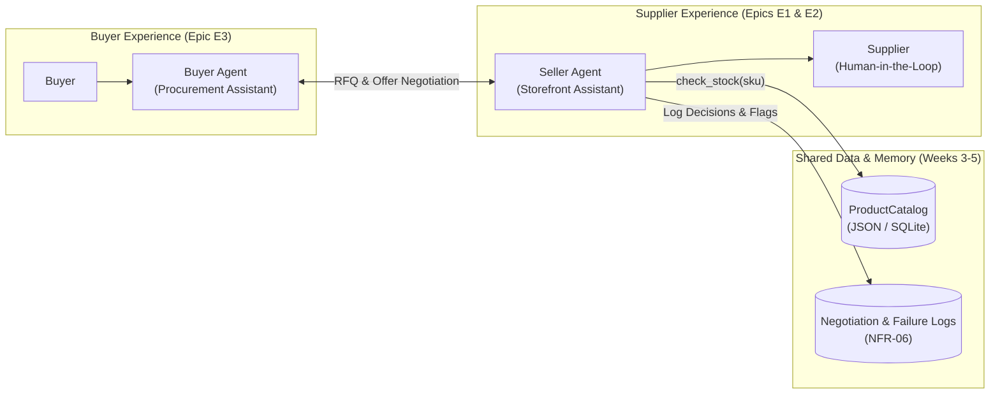

# eComMART Agentic Commerce System (`projects/`)

This directory houses the source code for the **eComMART AI Engineering Squad's** two core agents and shared data layer, built progressively over the 24-week curriculum.

---

## Architecture Overview

---

## Components

| Directory | Agent / Component | Epics & Stories Covered | Current Modules |
| :--- | :--- | :--- | :--- |
| [`seller-agent/`](seller-agent/) | **Seller Agent** | `E1` (Story 1.1, 1.2) · `E2` (Story 2.1, 2.2, 2.3) | [`counter_offer.py`](seller-agent/counter_offer.py) |
| [`buyer-agent/`](buyer-agent/) | **Buyer Agent** | `E3` (Story 3.1, 3.2) | Planned for Sprint 3 |
| [`shared/`](shared/) | **Shared Data & Schemas** | Catalog, BANT, RFQ models | [`sample_catalog.json`](shared/sample_catalog.json) |
